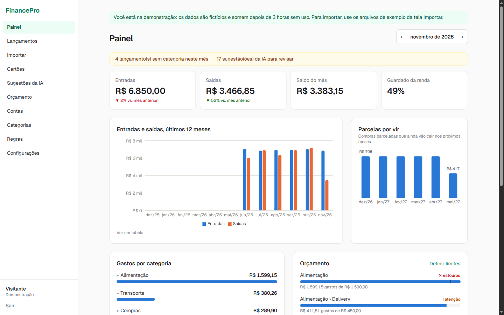
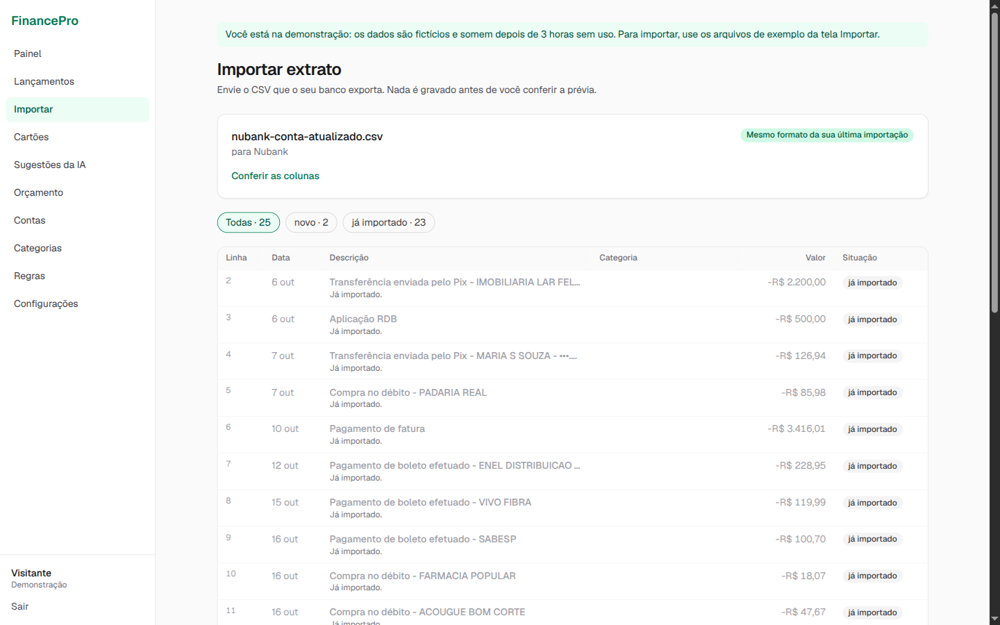
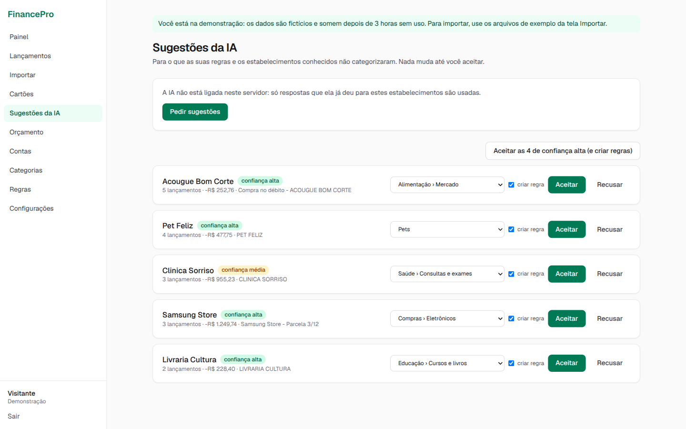
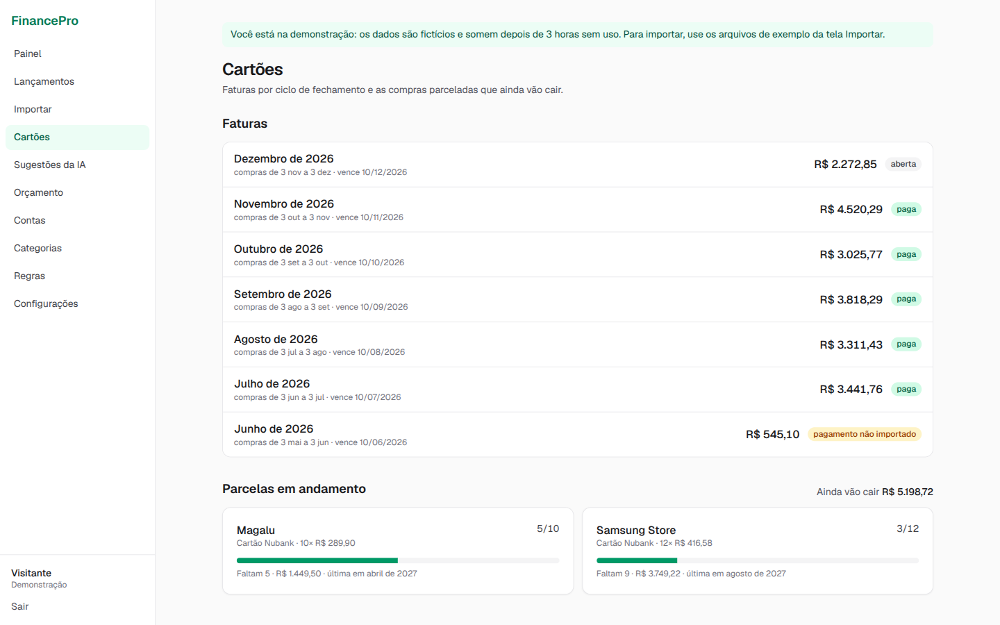

# FinancePro

Personal finance from your bank statements. Import the CSV your bank exports, get the spending categorized, and follow budgets on a dashboard. Categorization runs your own rules first, then built-in knowledge of Brazilian merchants, then Claude for what's left; a suggestion only counts once you accept it.

The interface is in Brazilian Portuguese; code and docs are in English.

**Live demo:** _coming with the deploy_. One click gives you a copy of your own with six months of fictional checking and credit card statements. No sign-up, deleted after 3 idle hours.



## What it does

| | |
|---|---|
| **Import** | Reads statements from any bank: UTF-8, BOM or Windows-1252; `;` or `,`; a title block before the header; amounts written as `-1.234,56`, `(12,34)`, `12,34 D` or `1,234.50`, with the decimal separator decided per column. Nubank checking and card exports match a preset; other layouts are detected from column names and content, and a corrected mapping is remembered for the next file. Nothing is written before you confirm the preview. |
| **Deduplication** | Re-importing a file adds nothing; an overlapping statement adds only what's new; two identical R$ 5 coffees on the same day stay two; a line you deleted doesn't come back; a description the bank rewrote between exports is flagged for you to decide. An import can be undone. |
| **Categorization** | Merchant normalization (`IFD*BURGER KING 4421 SAO PAULO BR` → iFood, Pix lines → "Pix para Maria Souza"), rules where the most specific one wins, built-in knowledge of about 90 Brazilian merchants and keywords, and AI suggestions for the rest. |
| **Credit cards** | The card is a liability account: purchases are spending, paying the bill is a transfer, so nothing counts twice. Statements by closing day. Installments ("Parcela 3/10") are grouped across statements and the ones still to come are projected. |
| **Transfers** | Bill payments are linked on import; other moves between your own accounts are suggested for you to confirm. Transfers are never income or spending. |
| **Budgets & reports** | Monthly limits per category with history, spent plus already-committed installments against each limit, income vs spending over 12 months, spending by category and merchant. |
| **AI** | Claude Haiku 5.5 with structured outputs constrained to a fixed taxonomy, 50 merchants per request, a cached prompt, answers cached for everyone, daily token ceilings enforced atomically. Only the merchant name leaves the server; lines about a person never do. Optional: without an API key everything else works. |

| Import preview | AI suggestions | Cards and installments |
|---|---|---|
|  |  |  |

## Decisions

| ADR | |
|---|---|
| [0001](docs/adr/0001-money-as-integer-cents.md) | Money as integer cents |
| [0002](docs/adr/0002-sessions-and-origin-check.md) | Server-side sessions behind a same-origin rewrite |
| [0003](docs/adr/0003-deduplication.md) | Recognizing a transaction already imported |
| [0004](docs/adr/0004-cards-installments-and-effective-date.md) | Credit cards, installments and the month a transaction counts in |
| [0005](docs/adr/0005-transfers.md) | Transfers between a person's own accounts |
| [0006](docs/adr/0006-ai-suggests-people-decide.md) | The AI suggests, people decide |
| [0007](docs/adr/0007-public-demo.md) | A public demo nobody can put real data into |

## How it's tested

- **Against a real PostgreSQL**: the deduplication keys, CHECK constraints, partial indexes and `ON CONFLICT` don't exist in a mock. Tests fail on any warning, so a deprecation is caught before an upgrade breaks it.
- **Isolation**: a test walks every API route that takes an id and checks that another person's id answers 404; a new route fails it until it's covered.
- **Hand-computed numbers**: reports for a month with a salary, rent by Pix, a refund, an installment and a bill payment; statement cycles around the closing day, including a closing day of 31 in February.
- **Properties** (Hypothesis): any amount survives the Brazilian and the dot-decimal formats; any text yields a merchant name.
- **Mutations**: removing the occurrence number from fingerprints, the ownership filter, the Origin check, the unambiguous-pair rule for transfers, or the atomic token ceiling each makes a test fail.
- **The AI without the network**: a fake classifier, plus a check of the exact request sent to the SDK and of a refusal.
- **Pinned fingerprints**: a test fixes the value of the fingerprint formula, so changing it by accident is impossible to miss.

## Stack

FastAPI · SQLAlchemy 2 · Alembic · PostgreSQL 16 · Anthropic SDK · Next.js 16 · React 19 · TanStack Query · Recharts · Tailwind 4 · uv. Deployed on Render (API, Docker), Vercel (web app, reaching the API through a same-origin `/api` rewrite so the session cookie is first-party) and Neon (PostgreSQL).

## Local development

```bash
docker compose up -d                       # PostgreSQL on :5437

cd backend
cp .env.example .env                       # ANTHROPIC_API_KEY is optional
uv sync
uv run alembic upgrade head
uv run uvicorn financepro.main:app --port 8020 --reload   # API on :8020, docs on /api/docs

cd ../frontend
npm install
npm run dev                                # http://localhost:3010 (proxies /api to :8020)
```

Sample statements to import are served at `/api/samples/nubank-conta.csv`, `nubank-conta-atualizado.csv` and `nubank-cartao.csv`. To run the public demo locally, start the API with `DEMO_MODE=true` and the web app with `NEXT_PUBLIC_DEMO_MODE=true`.

About the bank presets: they follow the public format of Nubank's exports and were not validated against real files. Anything they get wrong is corrected in the preview's column mapping, and the correction is remembered.

## Checks

```bash
cd backend
uv run ruff check . && uv run ruff format --check .
uv run mypy src tests migrations
uv run alembic check
uv run pytest                              # against the PostgreSQL above (database financepro_test)

cd ../frontend
npm run lint && npm run format:check && npm run typecheck && npm test && npm run build
```
